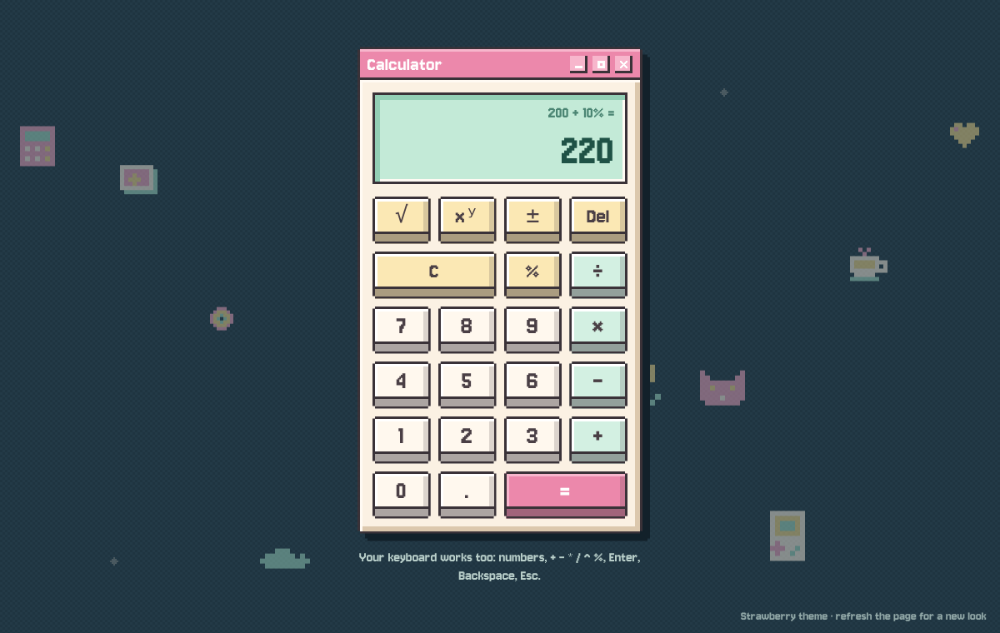

# Retro Calculator

A full-stack calculator: a React + TypeScript frontend styled as a retro pixel-art desktop window, backed by a Go REST microservice that does all of the arithmetic.



Every page load picks one of five pastel themes and draws a new set of drifting pixel icons behind the window:


## Contents

- [Features](#features)
- [Quick start (Docker)](#quick-start-docker)
- [Running locally](#running-locally)
- [Project structure](#project-structure)
- [API](#api)
- [Testing and coverage](#testing-and-coverage)
- [Design decisions](#design-decisions)
- [Assumptions and known limitations](#assumptions-and-known-limitations)
- [AI usage](#ai-usage)

## Features

**Operations:** addition, subtraction, multiplication and division, plus the optional exponentiation, square root and percentage. Each operation has its own REST endpoint.

**Backend (Go, standard library only)**
- Strict input validation: missing operands, wrong types, unknown fields, malformed or oversized bodies.
- Mathematical edge cases have their own error codes: division by zero, results that aren't real numbers (`√-4`), and overflow.
- Results are rounded to 15 significant digits, so `0.1 + 0.2` returns `0.3`.
- Consistent JSON envelope for every response, including 404 and 405.
- Structured request logging, panic recovery, server timeouts, graceful shutdown and a health endpoint.

**Frontend (React 19 + TypeScript)**
- Keypad calculator with a two-line display: the expression above, the result below.
- Full keyboard support.
- Results always fit the display: thousands separators, exponent notation for huge or tiny numbers, and never `NaN`, `Infinity` or `-0`.
- Readable error messages (`Can't divide by 0`, `Server offline`).
- Loading state; requests can be cancelled with C.
- Responsive from phone to desktop. Accessible: labelled keys, live-region results, visible focus, reduced-motion support.
- Working window controls: minimize, maximize, and close to a desktop icon.

**Delivery**
- Unit and component tests for both layers: 99.5% backend and 98.6% frontend statement coverage.
- GitHub Actions CI on every pull request: backend, frontend and a Docker image smoke test.
- One-command Docker image that serves the UI and the API from a single container.

## Quick start (Docker)

The only requirement is Docker.

```bash
docker build -t retro-calculator .
docker run --rm -p 8080:8080 retro-calculator
```

Open **http://localhost:8080**. The same container serves the frontend and the API, so there is nothing else to start. `docker compose up --build` works too.

> Port 8080 already in use? Map another one: `docker run --rm -p 8081:8080 retro-calculator`, then open http://localhost:8081.

## Running locally

Requirements: **Go 1.24+** and **Node.js 20+** (22 recommended, see `frontend/.nvmrc`).

Run the backend and the frontend in two terminals:

```bash
# Terminal 1: API on http://localhost:8080
cd backend
go run ./cmd

# Terminal 2: UI on http://localhost:5173
cd frontend
npm install
npm run dev
```

Open **http://localhost:5173**. In development the Vite server proxies `/api` and `/health` to the Go server, so the browser only ever talks to one origin and no CORS setup is needed.

The same tasks are available through `make` (run `make help` for the full list):

| Command | What it does |
|---|---|
| `make dev-backend` / `make dev-frontend` | Run each side in development mode |
| `make test` | Run all checks and tests for both layers |
| `make coverage` | Regenerate the coverage reports in `docs/coverage/` |
| `make docker-build` / `make docker-run` | Build and run the Docker image |

### Configuration

The backend reads environment variables. All of them are optional.

| Variable | Default | Purpose |
|---|---|---|
| `PORT` | `8080` | Port the server listens on |
| `STATIC_DIR` | unset | Also serve the built frontend from this directory (set in the Docker image) |
| `CORS_ALLOWED_ORIGIN` | unset (CORS off) | Allow browser calls from one other origin, e.g. a separately hosted frontend |

The frontend accepts `VITE_API_BASE_URL` at build time if the API lives on another origin. It is empty by default, which means the same origin.

## Project structure

```
.
├── backend/                     Go REST microservice (no third-party dependencies)
│   ├── cmd/main.go              Wiring, HTTP server, graceful shutdown, healthcheck mode
│   ├── internal/
│   │   ├── domain/service/      Calculator logic: pure functions + domain errors
│   │   ├── handler/             HTTP handlers, strict JSON decoding
│   │   ├── dto/                 Request / response shapes
│   │   ├── apperror/            API error codes and domain → HTTP mapping
│   │   ├── server/              JSON response envelope
│   │   ├── middleware/          Recovery, logging, CORS
│   │   └── router/              Routes, JSON 404/405, optional static frontend
│   └── pkg/config/              Environment configuration
├── frontend/                    React + TypeScript (Vite)
│   └── src/
│       ├── api/                 Typed API client
│       ├── calculator/          State machine (reducer), formatting, keys, hook
│       ├── components/          Calculator window, display, keypad, background
│       ├── background/          Pixel sprites and the random scene generator
│       └── theme/               Colour themes and random theme picker
├── docs/
│   ├── coverage/                Coverage reports (HTML + text)
│   └── screenshots/
├── Dockerfile                   Multi-stage build: Node → Go → distroless
├── compose.yaml
├── Makefile
├── .github/workflows/ci.yml     CI: backend, frontend, Docker image
└── PROMPTS.md                   AI prompts used to build this project
```

The backend follows the layered layout of my earlier Go project ([gghinzu/firstGoProject](https://github.com/gghinzu/firstGoProject)): `cmd → router → handler → service`, with DTOs, a shared response envelope and centralised errors.

## API

Base URL: `http://localhost:8080`. Request and response bodies are JSON.

### Endpoints

| Method | Path | Body | Result |
|---|---|---|---|
| `POST` | `/api/v1/add` | `{"a": n, "b": n}` | `a + b` |
| `POST` | `/api/v1/subtract` | `{"a": n, "b": n}` | `a − b` |
| `POST` | `/api/v1/multiply` | `{"a": n, "b": n}` | `a × b` |
| `POST` | `/api/v1/divide` | `{"a": n, "b": n}` | `a ÷ b` |
| `POST` | `/api/v1/power` | `{"a": n, "b": n}` | `a` to the power `b` |
| `POST` | `/api/v1/sqrt` | `{"a": n}` | `√a` |
| `POST` | `/api/v1/percentage` | `{"a": n, "b": n}` | `b` percent of `a`, i.e. `a × b / 100` |
| `GET` | `/health` | | `{"status": "ok"}` |

### Response format

Every response, success or error, uses the same envelope:

```json
{ "success": true,  "data":  { "operation": "divide", "result": 33.3333333333333 } }
{ "success": false, "error": { "code": "division_by_zero", "message": "division by zero is undefined" } }
```

### Examples

```bash
curl -X POST http://localhost:8080/api/v1/add -d '{"a": 0.1, "b": 0.2}'
# 200 {"success":true,"data":{"operation":"add","result":0.3}}

curl -X POST http://localhost:8080/api/v1/divide -d '{"a": 100, "b": 3}'
# 200 {"success":true,"data":{"operation":"divide","result":33.3333333333333}}

curl -X POST http://localhost:8080/api/v1/percentage -d '{"a": 200, "b": 10}'
# 200 {"success":true,"data":{"operation":"percentage","result":20}}

curl -X POST http://localhost:8080/api/v1/sqrt -d '{"a": 81}'
# 200 {"success":true,"data":{"operation":"sqrt","result":9}}

curl -X POST http://localhost:8080/api/v1/divide -d '{"a": 5, "b": 0}'
# 422 {"success":false,"error":{"code":"division_by_zero","message":"division by zero is undefined"}}

curl -X POST http://localhost:8080/api/v1/add -d '{"a": 5}'
# 400 {"success":false,"error":{"code":"missing_operand","message":"field \"b\" is required"}}

curl -X POST http://localhost:8080/api/v1/add -d '{"a": "5", "b": 1}'
# 400 {"success":false,"error":{"code":"invalid_operand","message":"field \"a\" must be a finite number"}}
```

### Error codes

| HTTP | Code | When |
|---|---|---|
| 400 | `empty_request_body` | No body |
| 400 | `invalid_json` | Malformed JSON, not a single object, or trailing data |
| 400 | `missing_operand` | `a` or `b` missing or `null` (an explicit `0` is valid) |
| 400 | `invalid_operand` | Operand is not a number, or outside the float64 range (e.g. `1e400`) |
| 400 | `unknown_field` | Unexpected field, e.g. `b` sent to `/sqrt` |
| 404 | `route_not_found` | No such endpoint |
| 405 | `method_not_allowed` | Wrong HTTP method (the `Allow` header lists the right one) |
| 413 | `request_too_large` | Body larger than 1 KiB |
| 422 | `division_by_zero` | `x / 0`, `0 / 0`, or `0` to a negative power |
| 422 | `undefined_result` | Not a real number: `√-4`, `(-8) ^ 0.5` |
| 422 | `result_out_of_range` | Result overflows float64, e.g. `1e308 × 10` |
| 500 | `internal_server_error` | Unexpected failure (details are logged, never returned) |

## Testing and coverage

```bash
make test        # everything below
```

```bash
# Backend: formatting, vet, tests with the race detector
cd backend && gofmt -l . && go vet ./... && go test -race ./...

# Frontend: lint, type-check + build, tests
cd frontend && npm run lint && npm run build && npm test
```

### Coverage

| Layer | Statements | Report |
|---|---|---|
| Backend (`internal/`, `pkg/`) | **99.5%** | [HTML](docs/coverage/backend.html) · [text](docs/coverage/backend.txt) |
| Frontend (`src/`) | **98.6%** (branches 96.6%, lines 99.6%) | [HTML](docs/coverage/frontend/index.html) · [text](docs/coverage/frontend.txt) |

The HTML reports are committed so they can be opened without installing anything; download the repository and open them in a browser. Regenerate them with `make coverage`.

**What is tested**
- **Backend:**
  - every operation with its edge cases, as table-driven tests;
  - HTTP handlers through `httptest`: success paths, every validation error, oversized bodies and hidden internal errors;
  - routing, including JSON 404/405 and static file serving with cache headers;
  - middleware, configuration and the healthcheck command.
- **Frontend:**
  - the calculator reducer: chaining, repeated `=`, the percent rules, errors and cancellation;
  - display formatting;
  - the API client with `fetch` mocked: errors, timeouts, aborts and malformed responses;
  - component tests with React Testing Library: clicks, keyboard, loading, cancelling, window controls;
  - the theme picker and background generator, plus a check that every theme in `themes.css` defines the same variables.

### Continuous integration

`.github/workflows/ci.yml` runs on every pull request and every push to `main`:
- **Backend:** `gofmt`, `go vet`, race-enabled tests and a coverage summary.
- **Frontend:** `npm ci`, ESLint, type-check and build, tests with coverage.
- **Docker image:** builds the image, waits for the container's health check, and checks that both the page and an API call work.

## Design decisions

**Standard library instead of a framework.** The service is a handful of JSON endpoints. Go 1.22+ routing (`POST /api/v1/add`) already handles methods and returns 404/405, so a framework such as Gin (used in my earlier project) would add a dependency without adding capability. The backend has **zero third-party dependencies**.

**One endpoint per operation.** The brief asks to "expose endpoints for calculator operations". Separate endpoints keep each operation independently addressable, documented and testable, and the handler code stays small: all binary operations share one decode → validate → calculate → respond function.

**Layered backend with a port interface.** The service layer has no knowledge of HTTP and returns domain errors. The handler depends on the `CalculatorServicePort` interface, so tests can substitute a fake. A fake is used, for example, to prove that internal errors are never leaked to clients. `apperror.FromDomain` is the single place where domain errors become HTTP errors.

**Missing operands are not zero.** Operands are decoded into `*float64`, so `{"a": 5}` is rejected as `missing_operand` instead of silently being treated as `5 + 0`.

**400 vs 422.** `400` means the request itself is wrong (malformed JSON, missing or invalid operands). `422` means the request is well-formed but the mathematics is undefined (division by zero, `√-4`, overflow). Clients can tell "fix your request" apart from "this has no answer".

**Precision: float64 rounded to 15 significant digits.** float64 represents about 15–17 significant decimal digits reliably. Rounding results to 15 removes binary floating-point noise (`0.1 + 0.2 = 0.30000000000000004` becomes `0.3`) without losing meaningful precision. An arbitrary-precision decimal library was considered, but it would add a dependency, and JSON numbers are float64 on most clients anyway.

**All arithmetic happens on the backend.** The frontend only edits the number being typed: digits, the decimal point, the sign, backspace. Every calculation, including `%` and `√`, is an API call. This keeps one source of truth for the maths and its edge cases.

**Frontend state as a pure reducer.** `calculatorReducer` never does arithmetic. When a key needs maths, it records the API request to make; the `useCalculator` hook performs it and reports back. The reducer stays pure and exhaustively unit-testable, and stale responses (after C) are ignored by request id.

**Immediate evaluation, like a pocket calculator.** `2 + 3 ×` shows `5` straight away. Repeated `=` repeats the last operation, and pressing another operator replaces the pending one.

**Percentage follows the iPhone calculator.**
- After `+` or `−`, `b %` means *b percent of the left operand*: `200 + 10 % =` gives `220`.
- After `×` or `÷`, or on its own, `b %` means `b / 100`: `50 × 10 % =` gives `5`.
- The API's `/percentage` endpoint is the plain `a × b / 100`; the key decides which operands to send.

**The display never shows nonsense.** Results are formatted to fit the screen: grouping, then exponent notation (`9.99999998e+17`), and tiny numbers are never rounded down to `0`. Errors show a short message while the attempted expression stays visible. A non-JSON 5xx (e.g. the dev proxy when the API is down) is shown as "Server offline", with details in the console.

**Design.** A retro pixel window inspired by a Pinterest moodboard.
- Bevels, notched corners, 3D keycaps and the drop shadow are all drawn in CSS from a single pixel unit (`--px`), so maximizing the window simply raises that unit.
- Colours are CSS variables in five themes; one is picked before the first render, never the same twice in a row.
- The background is a seeded, reproducible random scene of pixel icons drawn as SVG from text pixel maps.
- The font is Jersey 10, chosen over Pixelify Sans because its digits are unambiguous (`5` vs `S`); it is self-hosted, with no external requests.

**Docker: one container, one origin.** A multi-stage build compiles the frontend (Node 22) and a static Go binary (Go 1.24) into a `distroless/static:nonroot` image: no shell or package manager, running as an unprivileged user.
- The Go server serves the built frontend next to the API, so there is no CORS and no second container.
- Hashed assets are cached immutably; `index.html` is revalidated.
- The image has no `curl`, so the binary has a `healthcheck` mode for Docker's `HEALTHCHECK`.

**Git workflow.** Short-lived feature branches merged through pull requests once CI was green, with Conventional Commit messages.

## Assumptions and known limitations

- **Numbers are float64.**
  - Integers beyond 2^53 and very long decimals cannot be represented exactly. The UI limits input to 15 digits to stay within that range.
  - Results are rounded to 15 significant digits, which is ample for a calculator. Exact decimal or bignum arithmetic would need a decimal library.
- **No operator precedence or parentheses.** Evaluation is immediate, like a basic pocket calculator. Expression parsing was left out on purpose to keep the scope within the suggested 2–4 hours; it could be added as a `POST /api/v1/evaluate` endpoint with a small parser.
- **Percentage semantics** are an assumption, documented above, because "percentage" is ambiguous.
- **Not production-hardened.**
  - There is no authentication or rate limiting. Bodies are capped at 1 KiB and server timeouts are set.
  - A real deployment would add rate limiting at the edge and TLS termination.
- **Closing the window resets the calculator**, like quitting an app. Minimizing keeps its state.
- **Number formatting is English** (`1,234.5`); there is no localisation.

## AI usage

As the assignment allows, this project was built with an AI assistant (Claude). Every prompt that shaped the project, with what it produced and which decisions were mine, is recorded in **[PROMPTS.md](PROMPTS.md)**. All code was reviewed, run and committed by me, step by step, through the pull requests in this repository.
